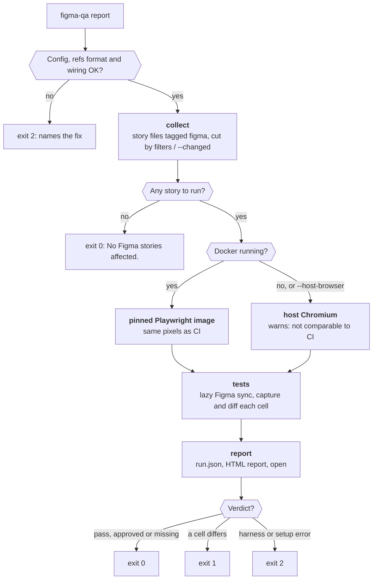

The command you run every time, aliased as `pnpm figma-report`. Run it after changing a component that has a Figma story, before a PR, or when an agent asks whether code matches Figma. It never prompts, so it behaves the same in a terminal, an agent session and CI.

## Synopsis

```sh
figma-qa report [filters...] [--changed [base]] [--ci] [--json] [--refresh] [--host-browser] [--no-open]
pnpm figma-report Swatch                  # one component
pnpm figma-report 'swatch-figma--*'       # a story-id glob
pnpm figma-report --changed origin/main   # only stories this branch reaches
```

| Flag | Effect |
| --- | --- |
| `filters` | Component names or story-id globs (`*`, `?`, `--`). Put them before `--changed`. |
| `--changed [base]` | Only Figma stories whose imports changed since `base` (default: uncommitted changes). |
| `--ci` | Opens nothing; writes `figma-qa/.results/summary.md`, the PR comment body ([CI / PR workflow](../ci.md)). |
| `--json` | Prints only the JSON summary on stdout. |
| `--refresh` | Fetches every linked set from Figma again instead of using cached refs. Needs `FIGMA_TOKEN`. |
| `--host-browser` | Uses the host's Chromium even when Docker runs. Pixels are then not comparable to CI. |
| `--no-open` | Doesn't open the HTML report. `BROWSER=none` does the same. |

## What it does



The one local command, aliased in a project's `package.json` as `"figma-report": "figma-qa report"` (`pnpm figma-report`). It never prompts and exits 0 (pass, approved or no code equivalent), 1 (a cell differs from Figma) or 2 (harness or setup error).

1. **doctor**: the config loads; the committed refs are in the kit's refs format (else exit 2 naming `figma-qa migrate`, or a kit upgrade for refs from a newer kit); `.storybook/main` adds the kit and Vitest has the `figma-qa` project, else exit 2 pointing at `figma-qa init`.
2. **collect**: story files from Storybook's `stories` globs are scanned as text; only files with a `figma` tag literal, or `tags` the scan can't read, are handed to Vitest.
3. **browser**, only once collect found a story to run (a `--changed` PR that reaches none pulls nothing): with Docker running, `docker compose up --wait` starts `mcr.microsoft.com/playwright:v<project's playwright>-noble` (compose project `figma-qa`, Playwright server on `127.0.0.1:29317`, or `$FIGMA_QA_BROWSER_PORT`, behind a per-user secret path kept in `~/.cache/figma-qa/browser-token`, left running for the next run). Without Docker, or with `--host-browser`, the host's Chromium runs and the summary and report warn that pixels are not comparable to CI. Docker running but the image failing to start is exit 2.
4. **tests**: Figma sync happens lazily per story. Each cell is captured once and its pixel diff runs in Node while the next cell is captured; each ref is flattened onto the page backdrop once per (ref hash, backdrop), kept in memory and under `node_modules/.cache/figma-qa/flat-v1`, so an unchanged ref is never flattened again.
5. **report**: `figma-qa/.results/run.json` and `figma-qa/.results/report/`. From a terminal (stdout a TTY, no `CI`) the report opens with `$BROWSER` or the platform's opener; `--no-open` or `BROWSER=none` opens nothing. With `storybook dev` running, the "Figma diff" panel URL is printed.

Each `fail` cell is triaged where code can tell, in its results JSON (`triage`), the panel and the report: `harness` (the image couldn't be measured: capture blocked, sizes differ; not a design verdict), `token` (a colour is another kit token than the one Figma names or equals by value; any other differing row is a spec number), `value` (every differing row is a spec number: size, radius, spacing, type), otherwise none. Under each failing cell the summary prints, and `--json` lists in the story's `failing`, an entry to paste into that block's `approved` with a reason; nothing rewrites story files.

Positional filters intersect the scanned files: a filter with `*`, `?` or `--` is a story-id glob (`'swatch-figma--*'`, other stories in a collected file are skipped), anything else a component name, matched against the meta `component`, the title or one of its segments, or the file name (`Swatch`, `Swatch.figma`). No match is exit 2. `--json` prints the summary, with `files`, per-phase `timings` (ms), `cellMs` (checks per captured cell, ms) and `panelUrl`, and nothing else on stdout.

`--changed [base]` keeps only the Figma story files a change reaches, through Vitest's own `changed`: files changed in `git diff base...HEAD` plus staged, unstaged and untracked ones (no base: only those), then each story file's import graph. A change to `.storybook/`, the refs dir, `figma-qa.config.*`, `package.json` or the Vite / Vitest config reaches every Figma story. Filters go before the flag (a following non-option argument is the base) and intersect it. A base git can't resolve (a shallow clone without it) or no repository is exit 2. Nothing affected is exit 0 with the warning `No Figma stories affected.`

`--ci` is the PR workflow's mode: it opens nothing, and picks the browser as a local run does (the pinned image when Docker runs, as it does on GitHub's Ubuntu runners). Beside the HTML report it writes `figma-qa/.results/summary.md`, the sticky comment's body: the `<!-- figma-qa -->` marker, the verdict, a per-story table of pass / fail / approved / missing cells and triage counts, and harness and setup errors (and `harness` cells) labelled "not a design verdict"; a rejected token adds "rotate the `FIGMA_TOKEN` repository secret".

## Response example

Vitest's own progress comes first: `✓` / `×` per story file and story. A `×` there only means the story's checks failed, and the summary below says why. The summary is one block per story, then run-level lines:

```text
ERROR src/Misconfigured.figma.stories.tsx › No Matrix: error: Story is tagged `figma` but has no `parameters.figmaMatrix.blocks`.
PASS  Swatch › Matrix: 2 pass, 0 fail, 2 approved, 2 missing
FAIL  Swatch › Matrix: 0 pass, 4 fail, 0 approved, 2 missing
      ✗ swatch · Size=Small, Tone=Brand [token]
        Component › Background (ΔEOK ≤ 0.01 as seen)
        - figma  hsl(228 69% 54.5%)  --color-brand
        + story  hsl(210 7.1% 55.7%)  --color-neutral  delta ΔEOK 0.219 · 75 RGB
        pixels: 96.1% differ (max 5%) → figma-qa/.results/swatch-figma-triage--matrix-10-1-diff.png
        approved: { when: { Size: ['Small'], Tone: ['Brand'] }, reason: 'TODO: why this deviation is deliberate (WCAG criterion or decision)' },
      ✗ swatch · Size=Large, Tone=Brand [value]
        Component › Width (±1px)
        - figma  40px
        + story  24px  delta −16px
        pixels: 61.6% differ (max 5%) → figma-qa/.results/swatch-figma-triage--matrix-10-4-diff.png
        approved: { when: { Size: ['Large'], Tone: ['Brand'] }, reason: '…' },
FAIL  Swatch › Blocked: 0 pass, 4 fail, 0 approved, 2 missing
      ✗ swatch · Size=Small, Tone=Brand [harness]
        pixels: not measured: Capture blocked: div.fixture-blocker covers the cell. Harness issue, not a design diff.
        not measured: fix the capture, no approval can cover it
WARN  Host Chromium (--host-browser): pixels are not comparable to CI.

figma-qa report: 2 pass, 8 fail, 2 approved, 6 missing (exit 2)
Timings: doctor 0.0 s, collect 1.1 s, browser 0.0 s, tests 2.2 s, report 0.0 s, per cell 78 ms
HTML report: figma-qa/.results/report/index.html
```

- **`PASS` / `FAIL` / `ERROR` `<title> › <story>`** is the story's verdict.
  - `ERROR` means the story measured nothing (misconfigured, uncached set, failed to render). It is exit 2, not a design verdict.
  - The counts are matrix cells, one per Figma variant. `approved` cells differ, but an `approved` entry in the story covers them. `missing` cells are variants Figma draws that the code doesn't have (`renderCell` returned null). Neither fails the run.
- **`✗ <block> · <variant> [<triage>]`** is a failing cell.
  - `[token]`: another kit token than Figma's.
  - `[value]`: a spec number is off.
  - `[harness]`: the capture couldn't be measured.
  - No tag: code can't tell, so this is where judgment goes. The lines under the cell say what differs; the HTML report shows it with the images.
- **Under each failing cell, what differs from Figma**, git-style:
  - `<element> › <property> (<tolerance>)` heads one differing spec row; the tolerance is what still counts as a match.
  - `- figma` is Figma's value and `+ story` the story's, each followed by the kit tokens it is, if any. `delta` (story minus Figma) ends the story's line when the row has one: a length, or a colour distance.
  - At most 5 rows per cell, then `… K more rows in <results file>` (the story's results JSON holds them all).
  - `pixels:` is the differing share against the story's max and the diff map's path, or `not measured: <reason>` when the capture couldn't be compared. The HTML report shows the same cell with its images.
  - Red `-` and green `+` only on a terminal with `NO_COLOR` unset; piped or captured output is plain text.
- **`approved: { … },`** is only for a deviation a human confirms is deliberate. Paste it into that block's `approved` and replace the `TODO` reason. A fix needs no entry. Harness cells print `not measured` instead, because no approval can cover them.
- **`ERROR <message>`** without a story is a run-level harness or setup error. It is exit 2, and the message names the fix (often `figma-qa init` or `--host-browser`).
- **`WARN`** lines never change the exit code. They cover host Chromium, Figma changed since the last sync, unnamed variables and `No Figma stories affected.`
- **The totals line** ends with the exit code. `Timings` show where the time went; `per cell` is the checks' time per captured cell (missing cells aren't captured), meant to stay ≤ 150 ms warm, reported and never gated. `HTML report` is the path to open. `Figma diff panel: <url>` follows when `storybook dev` is running.

`--json` prints only the summary on stdout; Vitest's output goes to stderr. The same object is written to `figma-qa/.results/run.json`:

```json
{
    "exitCode": 1,
    "hostBrowser": true,
    "cells": { "pass": 0, "fail": 8, "approved": 0, "missing": 4 },
    "files": ["src/SwatchTriage.figma.stories.tsx"],
    "stories": [
        {
            "storyId": "swatch-figma-triage--matrix",
            "title": "Swatch",
            "name": "Matrix",
            "file": "src/SwatchTriage.figma.stories.tsx",
            "verdict": "fail",
            "cells": { "pass": 0, "fail": 4, "approved": 0, "missing": 2 },
            "error": null,
            "results": "figma-qa/.results/results/swatch-figma-triage--matrix.json",
            "failing": [
                {
                    "block": "swatch",
                    "variant": "Size=Small, Tone=Brand",
                    "triage": "token",
                    "approved": "{ when: { Size: ['Small'], Tone: ['Brand'] }, reason: 'TODO: …' }"
                }
            ]
        }
    ],
    "errors": [],
    "warnings": ["Host Chromium (--host-browser): pixels are not comparable to CI."],
    "timings": { "doctor": 1, "collect": 1302, "browser": 0, "tests": 2822, "report": 30 },
    "cellMs": 89,
    "panelUrl": null
}
```

- **The verdict fields** are `exitCode`, `stories[].verdict` and `stories[].error`. `errors` holds failures outside any story.
- **`stories[].results`** points at the per-story results JSON. It has every cell's spec rows (`spec.mismatches`: element, property, `expected` (Figma), `actual` (story), `delta`, `tolerance`) and its pixel diff (`image`). Read that file to see what differs.
- **`failing[].approved`** is `null` for `harness` cells.


With `--ci` it also writes the PR comment body; see [CI / PR workflow](../ci.md#the-pr-comment).

## Exit codes

- **0**: every cell passes, is approved, or has no code equivalent (`missing`). Warnings never change it.
- **1**: a cell differs from Figma, or a cell couldn't be measured (`harness`).
- **2**: a harness or setup error: a misconfigured Figma story, an uncached set without a token, an unreachable browser, a rejected token, refs in another format. Never a design verdict.

## Related

- [Results UI](../reference/results-ui.md): the same results in the HTML report and the Storybook panel.
- [`figma-qa` skill](../skills.md#figma-qa): how an agent runs this and triages failing cells.
- [Figma stories](../figma-stories.md): `approved`, `missing` and filters, from the story's side.
