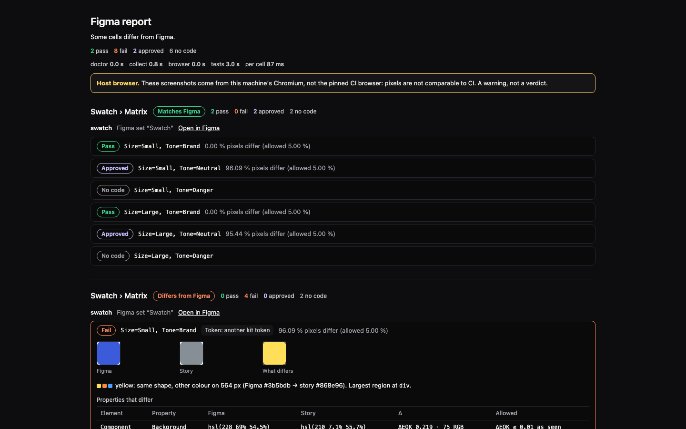
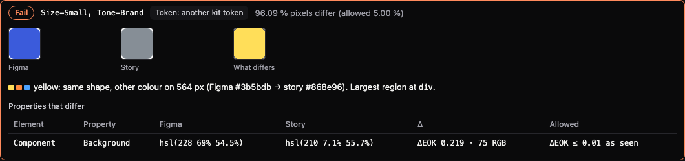
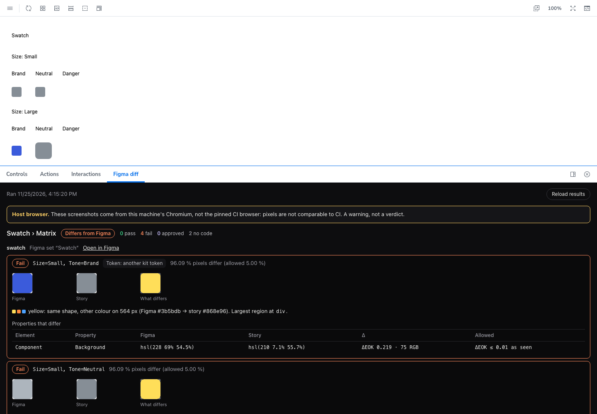
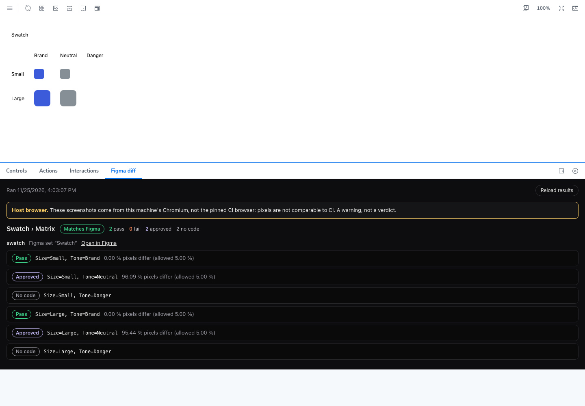

Every run writes its results to `figma-qa/.results/` (gitignored). Two views read them, built from the same components, so they can't disagree with each other or with the terminal. Screenshots are from `fixtures/sb11`, run with `--host-browser`.

## HTML report

`figma-qa/.results/report/index.html`. `report` opens it from a terminal; in CI it is the `figma-qa-report` artifact. One section per story: verdict, cell counts, timings, then every cell.

A failing cell opens by default: Figma's image, the story's image, the diff map ("What differs") with a one-line reading of its largest region, then the spec rows that differ, with the tolerance each is held to.

## Storybook panel

With `storybook dev` running, open a Figma story and the **Figma diff** addon panel: the last run's results for that story, beside the live matrix. **Reload results** picks up a new run without restarting Storybook. `report` prints the panel URL when Storybook is running.

## Designer notes

Dev Mode annotations the designer pinned inside a linked set show as plain text, with their line breaks kept. A note on the set sits under the block's heading. A note on a variant's layers sits inside its cell, under the layer path, and the cell's row carries a *1 note* tag, so a closed passing cell still shows it has one. Notes never change a verdict. REST sends text only, so the category, markdown and pinned properties don't show here; the `figma-qa` skill reads them through the Figma MCP.

## Banners

A run with host Chromium (no Docker, or `--host-browser`) carries this banner in both views. It is a warning: the verdicts stand, but the pixels aren't comparable to CI's.

## Cell labels

| Label | Verdict | Meaning |
| --- | --- | --- |
| Pass | `pass` | Matches Figma within tolerance. |
| Fail | `fail` | Differs. The tag next to it is the triage: *Token: another kit token*, a spec value, or *harness*. |
| Approved | `approved` | Differs, covered by an `approved` entry; its reason shows. |
| No code | `missing` | `renderCell` returned `null`. |
