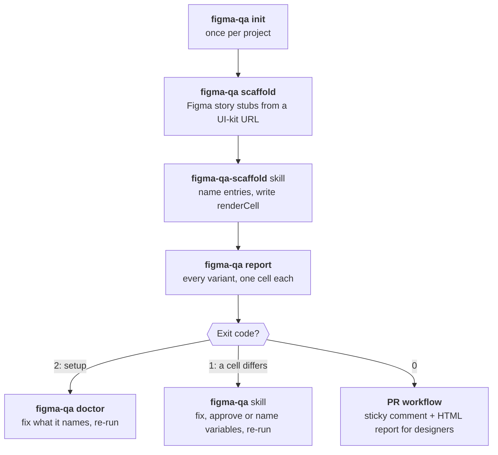

## Lifecycle

## Steps

1. **Set up once.** [`figma-qa init`](./commands/init.md) installs and wires the kit and the agent skills. Commit what it writes.
2. **Link a component.** [`figma-qa scaffold`](./commands/scaffold.md) writes a Figma story with one stub per component set. Every cell reports `missing` until the stubs are written, so the run still exits 0.
3. **Finish the story.** Your agent's [`figma-qa-scaffold` skill](./skills.md#figma-qa-scaffold) maps each Figma variant to the code's props in `renderCell`. A variant the code doesn't have returns `null` and stays `missing`.
4. **Run the report.** [`pnpm figma-report <Component>`](./commands/report.md). Commit the refs it syncs.
5. **Triage.** For each failing cell: fix the code, or, if the difference is deliberate, paste the printed `approved` entry with a reason. Cells tagged `[harness]` are the setup's problem, not the design's. The [`figma-qa` skill](./skills.md#figma-qa) does this pass and asks you only about approvals.
6. **Name variables** when the report warns about unnamed ones: [`figma-qa variables`](./commands/variables.md) with the Figma MCP.
7. **Open the PR.** The [PR workflow](./ci.md) re-checks the stories the PR reaches and posts one sticky comment with the HTML report for designers.

## Who does what

| Step | Human | Agent |
| --- | --- | --- |
| Figma token, Docker, the `FIGMA_TOKEN` repository secret | ✓ | |
| Scaffold, write `renderCell`, run the report, fix code | | ✓ |
| Decide a deviation is deliberate (approve) | ✓ | proposes |
| Name Figma variables | | ✓ (Figma MCP) |
| Review the PR comment and HTML report | ✓ (and designers) | |
